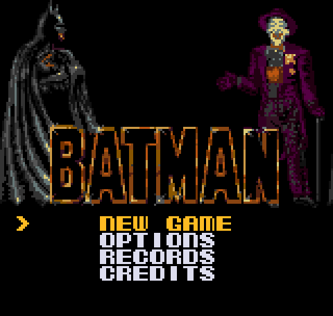
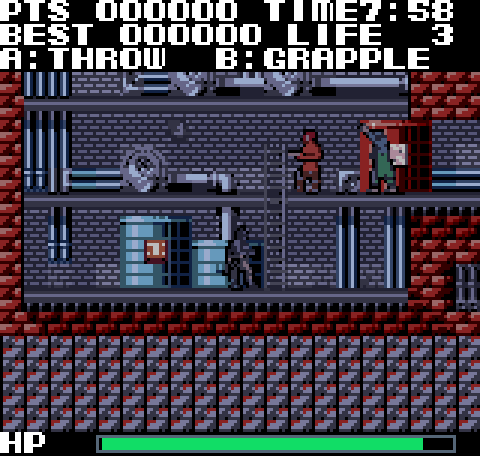
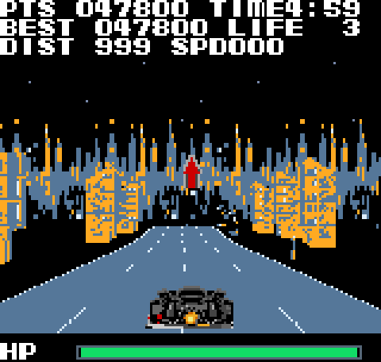
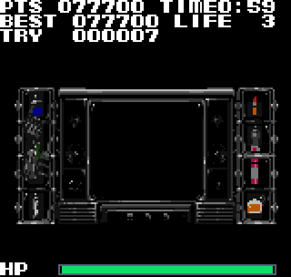
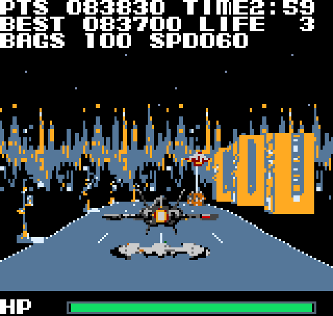
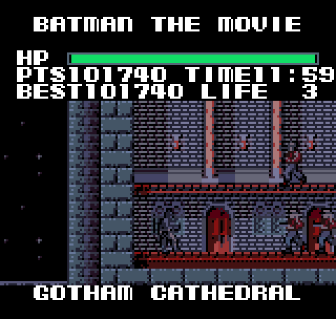
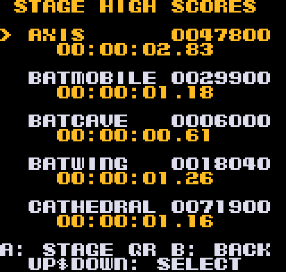

# Batman: The Movie — Neo Geo Pocket Color

An unofficial, non-commercial fan port of **Batman: The Movie** (Ocean, 1989) for the **Neo Geo Pocket Color**. Developed by **[jajabinx35-pixel](https://github.com/jajabinx35-pixel)** with substantial AI-assisted programming and optimisation, drawing on **[MarkyTurtle's Amiga disassembly](https://github.com/MarkyTurtle/Batman---Amiga)**.

> **Version 1.0.2 · busy-scene optimisation** — All five stages are implemented. The supplied normal cartridge ROM is 4 MiB. This project is intended for NGPC enthusiasts and real hardware, with NGPCraft and MAME-supported development testing. Actual console performance can differ from emulation.

## Gameplay

The port includes all five stages from the Amiga game, converted for the NGPC screen and hardware:

| Axis Chemicals | Batmobile | Batcave |
|:--:|:--:|:--:|
|  |  |  |

| Batwing | Gotham Cathedral |
|:--:|:--:|
|  |  |

**Features:** five stages; original-game-inspired graphics, music and sound effects; introduction; save/continue; stage and overall high scores; QR-based score submission screens; cheat mode; and engine optimisations for NGPC hardware.

The Earlier M66 scoring logic improves scoring fairness: after losing a life and replaying a checkpoint section, points already earned in that section cannot be farmed repeatedly. New progress can still increase the score. Starting with more than three lives or enabling cheats makes a run ineligible for ranked records. Starting a **new game** is recommended when upgrading from a pre-M66 save for ranked play.

## What's new in v1.0.2

- Targeted crowded-scene optimisation for **Axis Chemicals (stage 1)** and **Gotham Cathedral (stage 5)**, preserving actor logic, placement, display and sound behaviour in the tested scenarios.
- Matched NGPCraft sound-on 300-update diagnostics showed **+12.21% update throughput in stage 1** and **+12.63% in stage 5** versus v1.0.1; stages 2–4 remained at their previous measured cadence. These are **emulator replay results**, not full-game or real-console FPS guarantees.
- Save format, leaderboard payload, anti-farming rules and print artwork stay unchanged. See [v1.0.2 technical notes](DOCUMENTATION/V1.0.2_BUSY_SCENES_AND_TESTS.md) and [release notes](RELEASE_NOTES_v1.0.2.md).

## Screenshots and records

| Stage high scores | QR score display |
|:--:|:--:|
|  | 

Screenshots come from the project's bundled M65-era emulator test captures (160×152 pixels) and are shown enlarged 3× using nearest-neighbour scaling. The subsequent v1.0.2 work changes core processing, not these source graphics. These are not presented as freshly captured v1.0.2 hardware photographs. The QR image is an example test record, not a real leaderboard submission.

## Download / play

Download **`Batman_v1.0.2.ngc`** directly or **`Batman_NGPC_v1.0.2_Release.zip`** (with diagnostic ROM, manual and trailer) from [Releases](https://github.com/jajabinx35-pixel/Batman-NGPC/releases).

- **Normal game:** `Batman_v1.0.2.ngc` — use this to play on compatible NGPC flash hardware or an emulator configured with a legally obtained BIOS.
- **Diagnostic:** `Batman_v1.0.2_Diagnostic.ngc` — development/hardware measurements only, not the ordinary gameplay release.
- The separate release ZIP also includes printable case and manual artwork and a trailer.

**Controls:** the game's Options menu includes a Controls page. OPTION pauses; in gameplay **A throws**, **B grapples**, and **Down+B** performs the down/drop action where applicable. From Records → Stage High Scores select a cleared stage and press **A** to begin the score-upload initials flow; **OPTION** then shows the QR code. The QR displays a code for a compatible leaderboard service; showing it does not itself upload online.

Online acceptance of the stage-specific QR format requires support from the leaderboard website and is **not confirmed** by the bundled tests.

## Source code / builds

The `SOURCE/game` directory contains the NGPC port implementation. `SOURCE/tools` contains scripts, `BUILD_MY_ROM.bat` is the Windows build entry point, and `DOCUMENTATION` contains v1.0.2 checksums, optimisation/benchmark results, hardware checks and QR specifications.

The **Toshiba TLCS-900 toolchain is intentionally not redistributed** here because of its separate software licence. To build on Windows, place your own properly licensed copy of the Toshiba tools under `SOURCE/T900/` (including `BIN/cc900.exe`, `BIN/asm900.exe`, `BIN/tulink.exe` and `BIN/tuconv.exe`), then run `BUILD_MY_ROM.bat` from the repository root. It invokes the included PowerShell build script. Windows build from this toolchain-free GitHub package has not been independently re-tested. The Linux scripts may additionally require separately obtained legacy compatibility helpers (`linux_runner`, `wibo-compat`). See [BUILDING.md](BUILDING.md).

The exact ROM SHA-256 hashes can be checked against [DOCUMENTATION/FINAL_ROM_IDENTITIES.json](DOCUMENTATION/FINAL_ROM_IDENTITIES.json).

## Credits

- **NGPC port, testing and release:** jajabinx35-pixel, with extensive AI-assisted development.
- **Amiga disassembly / foundational reference:** **[MarkyTurtle](https://github.com/MarkyTurtle)**. Many thanks to Mark for publishing his work and for expressly welcoming ports derived from it. His GitHub username is also credited in-game.
- **Original game:** Batman: The Movie (1989), published by Ocean Software; original creators and rights holders retain their respective rights.

This is an unofficial fan project, not affiliated with or endorsed by SNK, Ocean, DC or Warner Bros. Mark's permission to reuse his disassembly does not confer rights in the original Batman property or other third-party assets. There is **no blanket open-source licence** being asserted for third-party artwork, music, characters or code.
